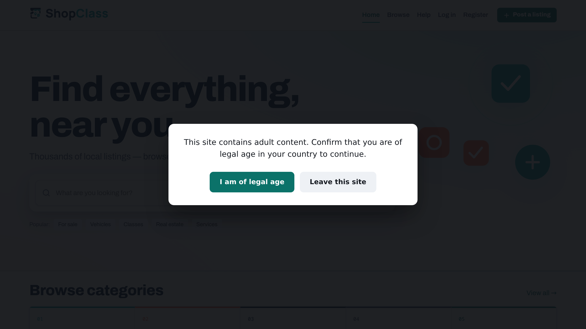

# Age Warning

Shows an age-confirmation notice before a visitor sees the site, and remembers the answer. For sites with adult listings that must show a notice.

## Requirements

- Shopclass 6.1.0 or later
- PHP 8.0 or later
- The theme must call the `header` and `footer` hooks. Without either, no notice shows.

## Install

1. Open Plugins → Browse (or upload the zip from the GitHub release).
2. Install.
3. Activate.

## Set up

1. Open Plugins → Manage plugins, then Settings next to Age Warning.
2. Edit the fields:

| Field | Default |
|---|---|
| Notice text | "This site contains adult content. Confirm that you are of legal age…" |
| Confirm button | "I am of legal age" |
| Decline button | "Leave this site" |
| Send decliners to | `https://www.google.com/` |
| Remember for (days) | 30 (1–365) |

3. Save.

Only `http://` and `https://` addresses work for the decline link. Anything else falls back to the default.

## How it works

- A full-screen notice covers the page until the visitor confirms.
- The answer is kept in a cookie for the number of days you set.
- A visitor who declines goes to your chosen address.
- The notice is in every page and hidden in the browser once confirmed, so it works with a page cache.
- With JavaScript off, the notice stays.

## Notes / limits

- It is a notice, not access control. The page is still sent to the browser, and a visitor can clear the cookie or read the source.
- Derived from the Osclass "Age warning" plugin (1.0.2). See CHANGELOG.md.

## Support

https://github.com/mindstellar/shopclass-plugins/issues

## License

GPL-3.0-or-later. Derived from Osclass (Apache-2.0); both notices are kept in the source headers.
