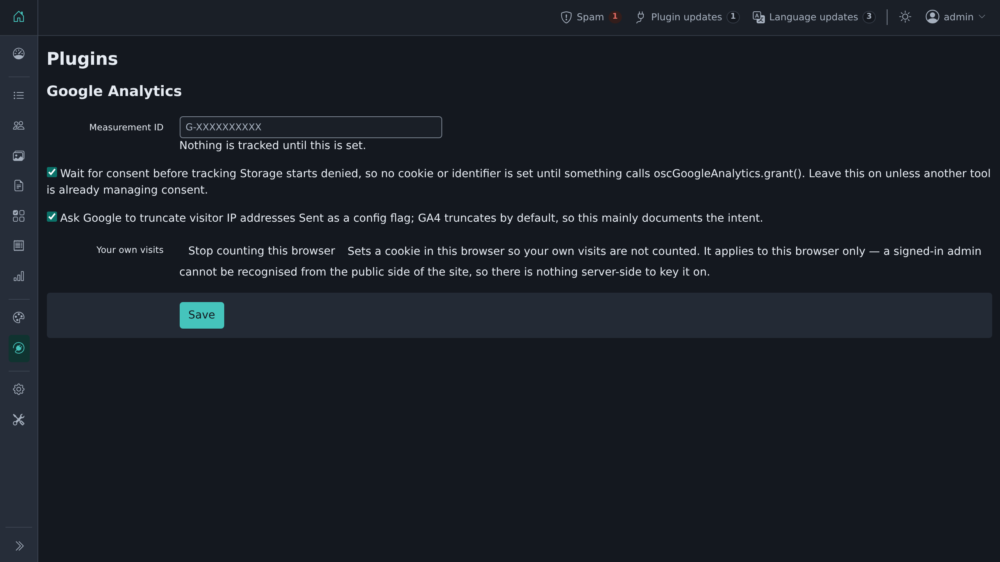

# Google Analytics

Adds Google Analytics 4 to the public side of your site, with consent gating and a per-browser opt-out.

## Requirements

- Shopclass 6.1.0 or later
- PHP 8.0 or later
- A Google Analytics 4 measurement ID

## Install

1. Open Plugins → Browse (or upload the zip from the GitHub release).
2. Install.
3. Activate.

If core already had a tracking ID (6.1.0 or earlier), install picks it up. No retyping.

## Set up

1. Open Plugins → Manage plugins, then Settings next to Google Analytics.
2. Enter the Measurement ID. It must start with `G-`, `GT-`, `UA-` or `AW-`. Anything else is refused.
3. Choose the switches: "Wait for consent before tracking" and "Ask Google to truncate visitor IP addresses".
4. Save.

## How it works

- Consent Mode starts with storage denied, before the library loads. gtag.js sets no cookie or identifier until consent is granted.
- Whatever asks the visitor calls `oscGoogleAnalytics.grant()` or `oscGoogleAnalytics.deny()`. Remembering the answer is the banner's job.
- Turn the consent switch off if another tool already manages consent for the page.
- The button "Stop counting this browser" marks this browser as not counted. Use it in each browser you visit from.
- It loads on the public side only, never in the admin. It works with a page cache.

## For developers

Filter `google_analytics_should_track`: return false to skip the tag for a request.

## Support

https://github.com/mindstellar/shopclass-plugins/issues

## License

GPL-3.0-or-later.
