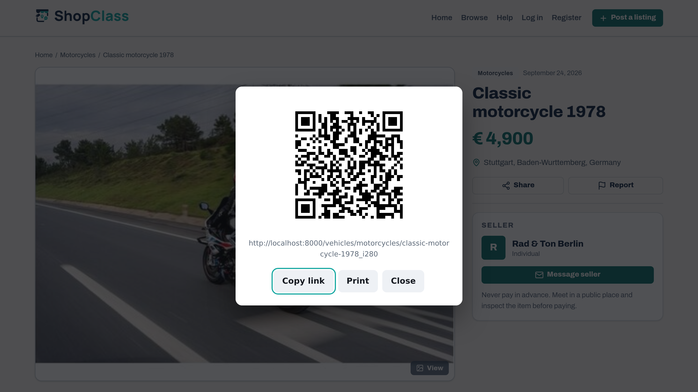

# QR Code

Adds a QR code to each listing, to scan from a screen, share or print.

## Requirements

- Shopclass 6.1.0 or later
- PHP 8.0 or later
- A browser with ES modules and dynamic `import()` (any browser since 2018)
- The theme must call the `item_detail` hook

## Install

1. Open Plugins → Browse (or upload the zip from the GitHub release).
2. Install.
3. Activate.

## Set up

1. Open Plugins → Manage plugins, then Settings next to QR Code.
2. Pick the Error correction level: L, M (recommended), Q or H.
3. Save.

M survives a scuffed print or an off-angle scan. H gives about 30% damage tolerance but a denser symbol.

## How it works

- Every listing page gets a "Show QR code" button. No theme edit needed.
- The code is drawn in the browser as SVG, only when asked, so it stays sharp in print. No files are stored on the server.
- The button opens a dialog with the code and the listing address.

| Action | When it shows |
|---|---|
| Share | The browser has the Web Share API |
| Copy link | The browser has the Clipboard API |
| Print | Always. Prints the code and address at 60 mm |

## Notes / limits

- Share and Copy link stay hidden until the browser supports them.
- `vendor/qrcode.js` and `vendor/qrcode-utf8.js` are QR Code Generator for JavaScript by Kazuhiko Arase (MIT), included unchanged. See `vendor/LICENSE`. The UTF-8 file is needed so URLs with non-ASCII characters scan correctly.
- Derived from the Osclass "QR Codes" plugin (1.0.3). See CHANGELOG.md.

## Support

https://github.com/mindstellar/shopclass-plugins/issues

## License

GPL-3.0-or-later. Derived from Osclass (Apache-2.0); both notices are kept in the source headers.
