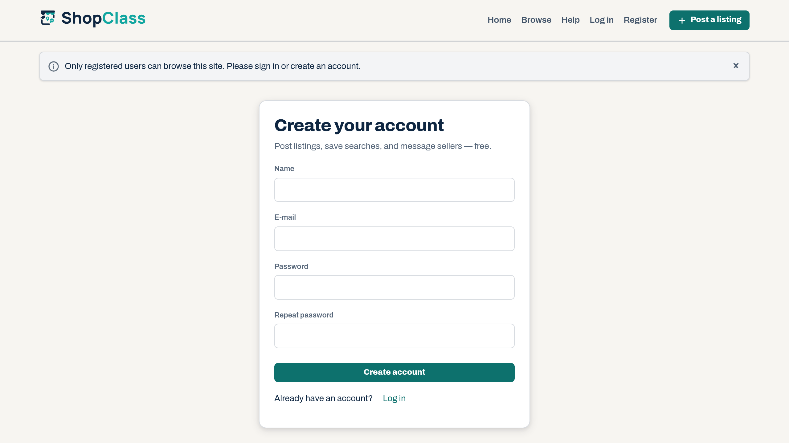

# Registered Users Only

Closes the site to visitors who are not signed in. You choose what stays public.

## Requirements

- Shopclass 6.1.0 or later
- PHP 8.0 or later

## Install

1. Open Plugins → Browse (or upload the zip from the GitHub release).
2. Install.
3. Activate.

## Set up

1. Open Plugins → Manage plugins, then Settings next to Registered Users Only.
2. Tick the areas that stay open to signed-out visitors. Everything not ticked is closed.

| Area | Default |
|---|---|
| Static pages (terms, privacy notice, imprint) | open |
| Contact form | open |
| Browsing and search (category listings, search results, sellers' public profiles) | closed |
| Individual listings | closed |

3. Save.

## How it works

- A signed-out visitor who asks for a closed page goes to the registration page with a message saying why.
- These are always open: sign in, register, password recovery, account activation, the error page, the sitemap, the feeds, the ajax endpoints, the cron entry point and a signed-in user's own account pages.

## Notes / limits

- Closing browsing and listings hides them from search engines too, since a crawler is a signed-out visitor.
- The redirect is cached for up to 30 seconds. A longer page cache, such as the nginx Cache plugin's, is purged on Shopclass 6.4.2 and later. On older versions, a page cached before activation can show for one cache window.
- Derived from the Osclass "Registered users only" plugin (0.9.3). See CHANGELOG.md.

## Support

https://github.com/mindstellar/shopclass-plugins/issues

## License

GPL-3.0-or-later. Derived from Osclass (Apache-2.0); both notices are kept in the source headers.
