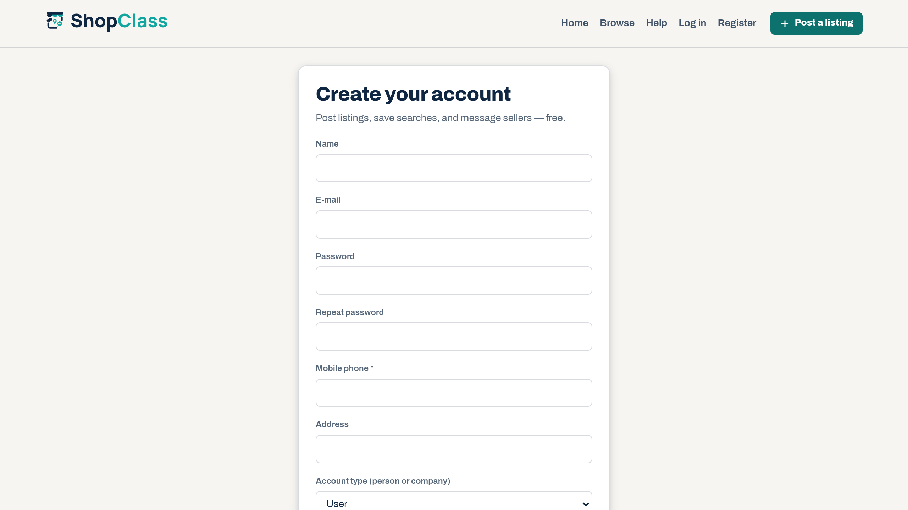

# Required Registration Fields

Adds profile fields to the registration form and lets you make some of them mandatory.

## Requirements

- Shopclass 6.1.0 or later
- PHP 8.0 or later

## Install

1. Open Plugins → Browse (or upload the zip from the GitHub release).
2. Install.
3. Activate.

## Set up

1. Open Plugins → Manage plugins, then Settings next to Required Registration Fields.
2. For each field, choose Not shown, Shown, optional or Shown, required. The fields are mobile phone, landline, website, address and account type (person or company).
3. Save.

Nothing is added until you choose, so installing changes nothing on its own.

## How it works

- The fields take the theme's own layout on the sign-up form.
- A required field is checked on the server when the account is created. A registration with an empty one is rejected and what was typed is kept.
- The form also carries the browser's `required` attribute, as a convenience only.
- Only the fields you turn on are written, each to its matching column on the new account. The column list is fixed in the plugin, so a request cannot reach a column you did not enable.

## Notes / limits

- Derived from the Osclass "Required Fields at Registration" plugin (1.0.6). See CHANGELOG.md.

## Support

https://github.com/mindstellar/shopclass-plugins/issues

## License

GPL-3.0-or-later. Derived from Osclass (Apache-2.0); both notices are kept in the source headers.
